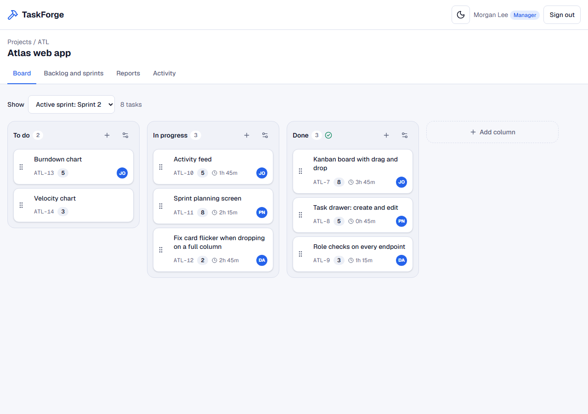
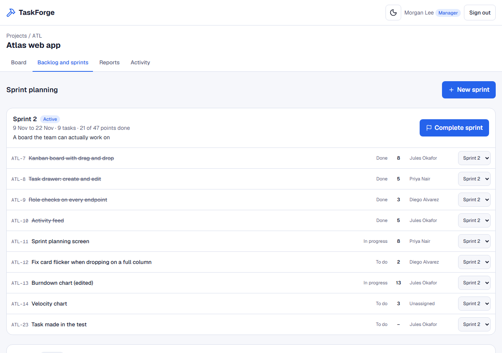
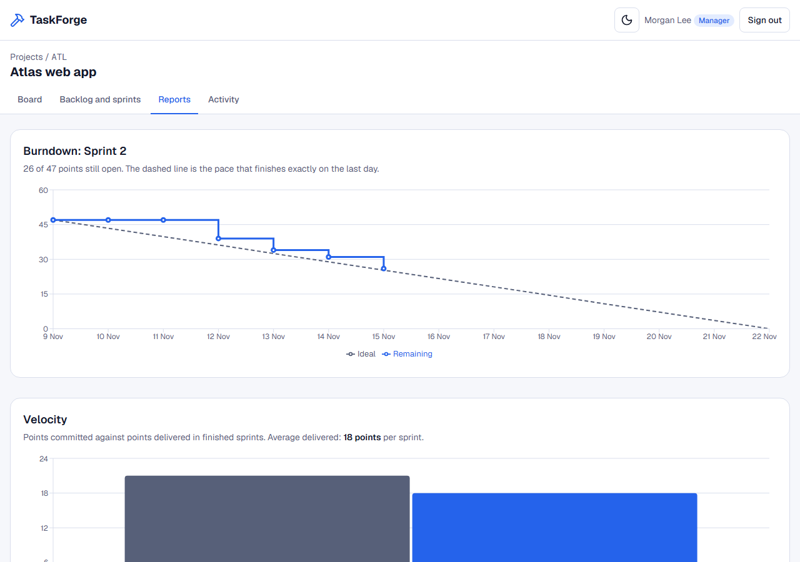
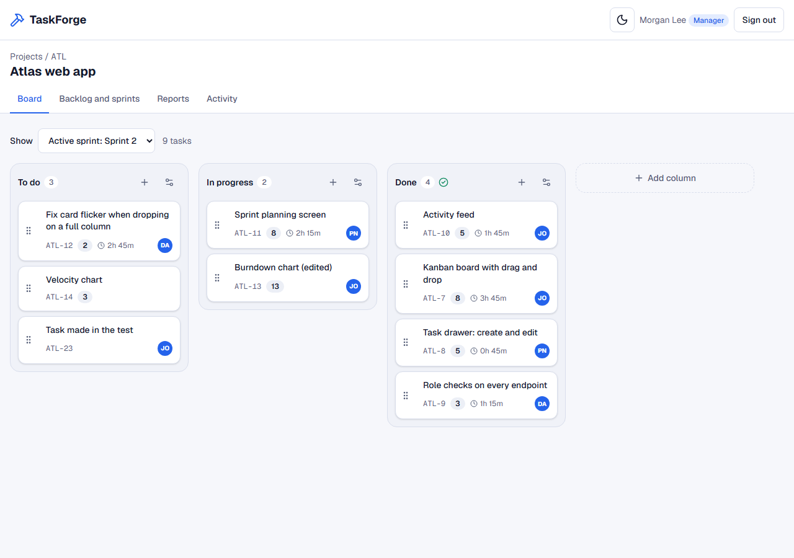
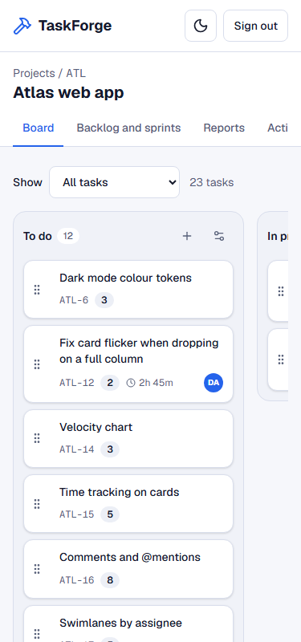

# TaskForge

A Jira-style project workspace: Kanban boards you can drag cards around, sprint planning with story points, burndown and velocity charts, and an audit trail of every change, all gated by three roles that are enforced on the server.

**Live demo:** TBD (built and tested locally, not yet deployed)



## What to demo to a recruiter
- Sign in with **Try the demo** as the **Manager**, open the Atlas project and drag a card from In progress to Done. Reload: it stays. Do it again with the keyboard (focus the grip, Space, arrow keys, Space). Then open **Reports** to see the burndown move.
- Sign out and sign in as the **Contributor**. The column and sprint controls are gone, the assignee and sprint fields are read-only, and the API answers 403 to anything structural, so hiding buttons is not the only protection.
- Back as the Manager, complete the active sprint on **Backlog and sprints**: unfinished cards return to the backlog, the sprint is snapshotted into **Velocity**, and every step shows up by name in **Activity**.

## Features
- **Kanban board:** custom columns (add, rename, delete, mark as "done"), cards with points, assignee and tracked time, a task drawer for create and edit, and a status select as the touch and keyboard alternative to dragging.
- **Drag and drop (dnd-kit):** pointer and keyboard, with spoken announcements. Moves are optimistic and roll back with an error if the server refuses. A drop writes one number, not the whole column.
- **Roles:** Admin, Manager and Contributor, checked on every mutation from a single permission matrix that is re-read from the database on each request (a demoted manager loses their powers immediately).
- **Sprints:** backlog, plan tasks into sprints, start (one active at a time) and complete (unfinished work returns to the backlog, points are snapshotted).
- **Reports:** burndown for the active sprint against an ideal line, and a velocity chart of committed versus delivered points.
- **Activity feed:** every change written by one server helper, with who did what in plain words.
- **Projects:** create with a key (task numbers read `ATL-12`), delete (admins only).
- Dark and light theme, keyboard accessible, responsive from 375px.

### Phase 2
- Swimlanes by assignee or priority
- Comments and @mentions
- Live board updates by short polling or server-sent events
- CSV export

## Stack
Next.js 16 (App Router), React 19, TypeScript (strict), Tailwind CSS 4, Zustand, dnd-kit, Recharts, Drizzle ORM with Neon Postgres, Auth.js (credentials, bcrypt), zod, Vitest.

## Architecture notes
- **Fractional ordering.** Cards and columns have a `double precision` position. Dropping a card between two others writes the midpoint to that one row. If repeated drops squeeze two neighbours together, the column is renumbered once and the position is worked out again. The client names the cards it was dropped between and the **server** computes the number from live data, so a stale board can't corrupt the order (an inconsistent pair is corrected from the real order).
- **Permissions in one place.** `lib/permissions.ts` is a single matrix. Services call `assertCan(actor, action)` before touching data; the UI uses `can()` only to hide buttons. Even field-level rules (a contributor may edit a task's text but not reassign it or plan it into a sprint) are enforced server-side.
- **Optimistic store.** A Zustand store seeded from the server render updates first and confirms after: on failure the change is rolled back and a banner explains why. Moves into or out of a done column also stamp or clear `completedAt`, which is what the burndown reads.
- **Burndown and velocity are pure functions** (`lib/sprint-math.ts`) with unit tests. Velocity uses snapshots taken when a sprint completes, because completing moves unfinished cards out of it.
- **Task numbers** come from one atomic `UPDATE ... RETURNING` counter, so two people creating at the same moment never share a number (covered by a test).
- **Audit log.** `logActivity` is the only writer, called once per mutation.
- **Tests.** 12 unit tests (permissions, ordering, sprint maths) and 14 integration tests against the real Neon database with throwaway users (role matrix, concurrent numbering, drag ordering, stale clients, forced renumbering, sprint lifecycle, audit entries). An automated browser run (37 checks) covers real mouse and keyboard dragging, persistence across a reload, the three roles in the UI and over the API, and mobile.

Everyone signed in sees every project (roles are global). Per-project membership would be the next step.

## Run locally
```bash
npm install
cp .env.example .env.local     # DATABASE_URL, DATABASE_URL_UNPOOLED, AUTH_SECRET, AUTH_URL
npm run db:migrate             # create the tables
npm run db:seed                # demo people, the Atlas project, three sprints, 22 tasks
npm run dev                    # http://localhost:3002
```
Demo logins (password `demo1234`): `ava@demo.taskforge` (admin), `morgan@demo.taskforge` (manager), `jules@demo.taskforge` (contributor).
Checks: `npm run typecheck`, `npm run lint`, `npm test`, `npm run build`.

## Screenshots
| Backlog and sprints | Reports | Task drawer | Phone |
| --- | --- | --- | --- |
|  |  |  |  |

## Status
Built and tested locally. Deploy pending (needs `DATABASE_URL`, `AUTH_SECRET` and `AUTH_URL` in Netlify's environment).
